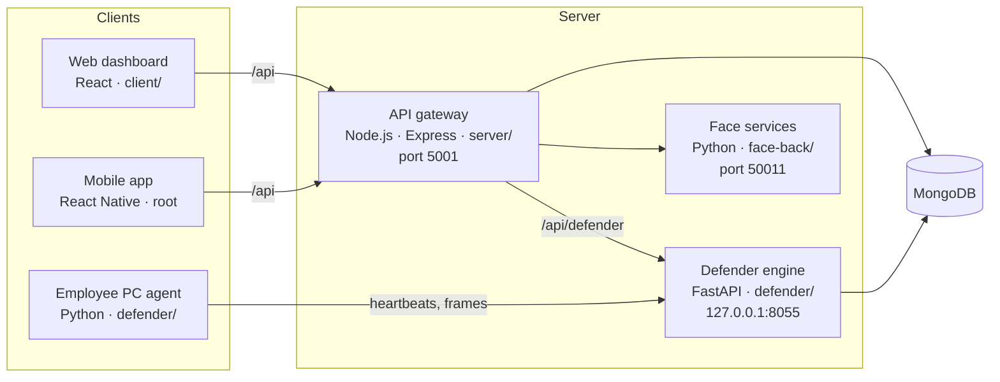

<div align="center">

# Anuvadini — Attendance + Defender

**Biometric attendance, live workplace monitoring and a reporting dashboard — in one platform.**

[](https://nodejs.org)
[](https://www.python.org)
[](https://react.dev)
[](https://fastapi.tiangolo.com)
[](https://www.mongodb.com)
[](LICENSE)

[Overview](#-overview) · [Architecture](#-architecture) · [Quick start](#-quick-start) · [Configuration](#-configuration) · [Deployment](#-deployment) · [Security](#-security--privacy) · [Troubleshooting](#-troubleshooting)

</div>

---

## ✨ Overview

Anuvadini brings two closely connected systems together:

| | What it does | Who uses it |
|---|---|---|
| **🗓️ Attendance** | Face-verified check-in and check-out, geofencing, leave and work-from-home requests, timesheets, spot checks, reports | Faculty, heads of institute (HOI), super admins, students |
| **🛡️ Defender** | Workplace monitoring on employee PCs: screen time, apps and websites, focus, live screens, incidents, firewall exceptions, reports | Administrators and HR |

Both share one login, one database and one dashboard, with an **Attendance / Defender** switch in the sidebar.

## 🚀 Highlights

- **Face attendance** with liveness and anti-spoofing checks (ArcFace / FaceNet-style matching, PAD models in `face-back/`)
- **Live Defender dashboard**: workstation health, live screens, webcam (only where the admin allows it), incidents by category
- **Usage history**: screen time and focus per person, team or everyone; website and app **focus rules**; tracking exclusions
- **Reports**: CSV exports (day by day, apps and sites, incidents) and PDF reports for a person, a team or everyone, over any date range
- **Mobile app** (React Native / Expo) in the repository root
- **Operations**: PM2, Docker Compose, Kubernetes manifests and Nginx configuration included

---

## 🏗️ Architecture



| Part | Folder | Stack | Default port |
|---|---|---|---|
| API gateway (attendance + auth + proxy to Defender) | `server/` | Node.js, Express, Mongoose | `5001` (`PORT`) |
| Defender engine (monitoring API, usage, reports) | `defender/` | Python, FastAPI, Uvicorn, PyMongo | `127.0.0.1:8055` |
| PC agent (runs on employee machines) | `defender/anuvadini_detector/` | Python, PyInstaller build | — |
| Face verification and anti-spoofing | `face-back/` | Python, Waitress | `50011` |
| Web dashboard | `client/` | React (Create React App + craco) | dev `19055` |
| Mobile app | root (`App.js`, `src/`, `ios/`) | React Native, Expo | — |

## 📁 Repository layout

```text
.
├── server/                  # Node.js API gateway (auth, attendance, portal, Defender proxy)
│   ├── index.js             # entry point (PORT, Mongo, routes)
│   ├── routes/ middleware/ models/ services/ controllers/ scripts/
│   └── env.example          # every setting, with placeholders only
├── defender/                # Defender engine + PC agent
│   ├── main.py              # starts the engine (uvicorn)
│   ├── requirements.txt
│   ├── anuvadini_detector/  # monitoring, usage, firewall, reports, agent
│   └── AnuvadiniDefender.spec / build_exe.ps1   # PC agent packaging
├── client/                  # React dashboard (Attendance + Defender pages)
│   └── src/pages/defender/  # Defender pages: People & teams, Usage history, Live screens…
├── face-back/               # face verification + anti-spoofing services
├── src/ App.js index.js     # React Native mobile app
├── ios/ eas.json            # mobile platform projects / build config
├── docs/                    # design and operations notes
├── scripts/ patches/        # helper scripts and patches
├── docker-compose.yml       # local stack (backend, Mongo, Redis, dashboard, Nginx, monitoring)
├── Dockerfile.backend / Dockerfile.web
├── k8s-manifests.yaml       # Kubernetes example
├── ecosystem.config.js      # PM2 process file (no secrets; read from environment)
└── nginx.conf / nginx.conf.template
```

---

## ⚡ Quick start

### 1. Prerequisites

- **Node.js 18+** and npm
- **Python 3.10+**
- **MongoDB** (Atlas or self-hosted)
- Optional: **Docker** and Docker Compose, **PM2** for process management

### 2. Clone

```bash
git clone https://github.com/Mohan-Sai-Kompelli/Anuvadini-Defender.git
cd Anuvadini-Defender
```

### 3. Configure

Copy the example settings and fill in **your own** values. Never commit real values.

```bash
cp server/env.example server/.env
```

See [Configuration](#-configuration) for every variable.

### 4. Start the API gateway

```bash
cd server
npm install
npm start
```

### 5. Start the Defender engine

```bash
cd defender
python -m venv .venv
source .venv/bin/activate        # Windows: .venv\Scripts\activate
pip install -r requirements.txt
python main.py
```

### 6. Start the dashboard

```bash
cd client
npm install
npm start                        # development server
```

For a production build:

```bash
cd client
REACT_APP_API_URL=https://your-domain.example/api npm run build
```

> `REACT_APP_API_URL` **must** be set at build time. If it is missing, the dashboard falls back to `http://localhost:5001/api`, and sign-in breaks for everyone who is not on that machine.

### 7. (Optional) Face services

```bash
cd face-back
pip install -r requirements.txt
python check.py                  # served with Waitress on port 50011
```

The face-model weights (for example `face-back/deepixbis/DeePixBiS.pth`) are **not** included in this repository. Place them there yourself, following the model's own licence.

### 8. (Optional) Mobile app

```bash
npm install
npm start
```

---

## ⚙️ Configuration

All settings are read from environment variables. Values are never stored in this repository.

<details>
<summary><b>API gateway (<code>server/</code>)</b></summary>

| Variable | Purpose |
|---|---|
| `MONGODB_URI` | Main database connection string |
| `MONGO_URI` | Alternative name used by some scripts |
| `PORT` | HTTP port (default `5001`) |
| `JWT_SECRET`, `JWT_EXPIRE` | Token signing and lifetime. **Required** (no default) |
| `AUDIT_HMAC_SECRET`, `LIVENESS_HMAC_SECRET` | Signing keys for the audit log and liveness checks. **Required** (fall back to `JWT_SECRET` if unset) |
| `SUPER_ADMIN_KEY` | Key for super-admin setup routes |
| `DEFENDER_URL` | Address of the Defender engine (default `http://127.0.0.1:8055`) |
| `DEFENDER_PUBLIC_URL` | Public address used for PC installers and links |
| `DEFENDER_AUTOSTART` | Set to `0` to stop the gateway from starting the engine itself |
| `FACE_API_URL`, `FACE_API_URLS` | Face verification service address(es) |
| `FIREBASE_SERVICE_ACCOUNT_KEY` | Path or JSON for push notifications (never commit the file) |
| `SENDGRID_API_KEY`, `SMTP_HOST`, `SMTP_PORT`, `SMTP_SECURE`, `SMTP_PASS` | Outgoing email |
| `SPOTCHECK_WINDOW`, `SPOTCHECK_BATCH_SIZE`, `SPOTCHECK_MAX_PER_STUDENT_PER_DAY`, `SPOT_CHECK_MIN_SIMILARITY` | Spot-check behaviour |
| `ANTISPOOF_SCREEN_BLOCK_CHECKINOUT` | Block check-in when a screen replay is suspected |
| `ACTIVITY_LOG_BUFFER_MIN`, `MISMATCH_ALERT_MAX_SIMILARITY` | Logging and alert thresholds |

</details>

<details>
<summary><b>Defender engine (<code>defender/</code>)</b></summary>

| Variable | Purpose |
|---|---|
| `MONGO_URI` / `MONGODB_URI` | Database connection string |
| `MONGO_DB_NAME` | Database name |
| `MONITOR_SERVER_HOST`, `MONITOR_SERVER_PORT`, `PORT` | Where the engine listens (default `127.0.0.1:8055`) |
| `ANUVADINI_SERVER_HOST`, `ANUVADINI_AGENT_MODE` | How the PC agent reaches the server |
| `NVIDIA_API_KEY`, `NVIDIA_VLM_API_KEY`, `NVIDIA_VLM_MODEL` | Optional AI review of screenshots |
| `FACE_MATCH_THRESHOLD`, `MIN_FACE_ENROLL_IMAGES`, `FACE_MIN_IMAGE_SIDE`, `FACE_MIN_AREA_RATIO`, `FACE_NIGHT_MEAN_GRAY`, `FACE_OUTLIER_SIM_FLOOR` | Webcam face-check tuning |
| `DEFENDER_SEED_DEMO`, `SEED_DEMO_FLEET` | Load demo data (development only) |

</details>

<details>
<summary><b>Dashboard (<code>client/</code>)</b></summary>

| Variable | Purpose |
|---|---|
| `REACT_APP_API_URL` | Public API base, for example `https://your-domain.example/api` (**set at build time**) |
| `REACT_APP_GOOGLE_MAPS_API_KEY` | Map views (restrict the key to your domains) |

</details>

---

## 🧭 Using Defender

- **People & teams** — screen time, focused time, apps and sites, incidents for one person or a team; download CSV or PDF reports.
- **Usage history** — webcam access, music bar access, teams, tracking exclusions, and **focus rules** (time spent in chosen apps or websites).
- **Live screens** — live view of employee PCs. The webcam panel appears only where the admin has allowed the webcam.
- **Incidents and Analytics** — detections by category and by person.
- **Engine and agents** — engine on/off, office hours, PC installers.

> Keyboard and mouse activity is counted as **hands-on time**, never as keystrokes or pointer positions. Focused time counts only inside keyboard-and-mouse time.

---

## 🚢 Deployment

**PM2 (single server).** `ecosystem.config.js` reads every secret from the environment. Set the variables in your shell or a secrets manager, then:

```bash
pm2 start ecosystem.config.js
pm2 save
```

**Docker Compose (local or small server).**

```bash
docker compose up -d --build
```

**Kubernetes.** Edit `k8s-manifests.yaml`: create the secret named there from your own values, then apply the manifests.

**Nginx.** Use `nginx.conf` (or `nginx.conf.template`) as a starting point. Terminate TLS in front of the gateway, and proxy `/api` to port `5001`.

**PC agent.** Build the Windows agent with `defender/build_exe.ps1` (PyInstaller, using `AnuvadiniDefender.spec`). Distribute it only to devices whose users have been informed.

---

## 🔐 Security & privacy

- **Never commit** `.env` files, service-account JSON, private keys, or database URIs with passwords. `.gitignore` already excludes the usual files.
- **Rotate** any database password that has ever appeared in source files or in an older commit, and set the new one only in the environment.
- **Face and biometric data** (enrolment images, embeddings) and **employee monitoring data** (screenshots, usage records, incidents) are personal data. Keep them in the database or storage on your server, not in the repository.
- The Defender agent counts **keyboard and mouse activity as time only**. It does not record keystrokes or pointer positions.
- Webcam capture happens **only** for people the administrator has allowed, and only while the employee has not switched their own camera off.
- Give the people being monitored clear notice of what is recorded and why.

---

## 🧪 Testing

```bash
cd client && npm test          # dashboard tests (Create React App)
```

Defender engine checks are in `defender/tests/`.

---

## 🩺 Troubleshooting

| Symptom | Likely cause | Fix |
|---|---|---|
| Sign-in fails for everyone except one machine | Dashboard built without `REACT_APP_API_URL` | Rebuild with `REACT_APP_API_URL=https://your-domain/api` |
| "Defender engine is not running" | Engine stopped or wrong `DEFENDER_URL` | Start `defender/main.py`; check port `8055` |
| Biometric or attendance lookups time out | Local `BIOMETRIC_MONGODB_URI` database not running | Start that MongoDB instance or point it at a running server |
| Live screens show "No live signal" | Agent not sending frames, or the browser lacks the sign-in token | Check the agent is online; sign in again |
| PDF download fails with 503 | `reportlab` not installed in the engine's environment | `pip install -r defender/requirements.txt` |
| Face check always says "No match" | Enrolment images missing, or threshold too strict | Re-enrol with more images; review `FACE_MATCH_THRESHOLD` |

---

## 🤝 Contributing

1. Create a branch from `main`.
2. Keep secrets, personal data and build output out of commits.
3. Run the checks above, then open a pull request with a short description of the change.

## 📄 Licence

See [LICENSE](LICENSE).

---

<div align="center">

Made for safe, fair and well-run workplaces and campuses. ✨

</div>
